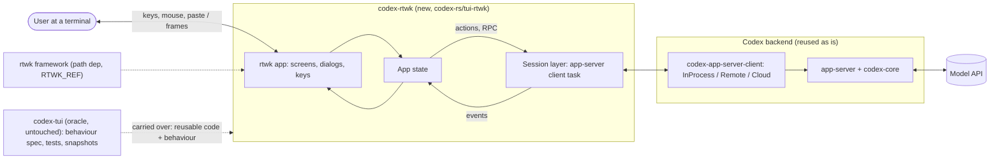
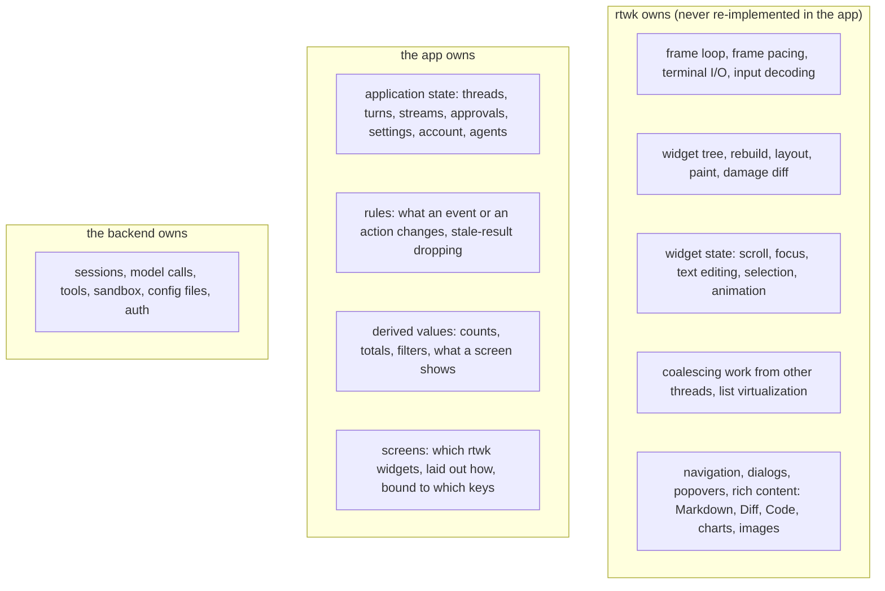
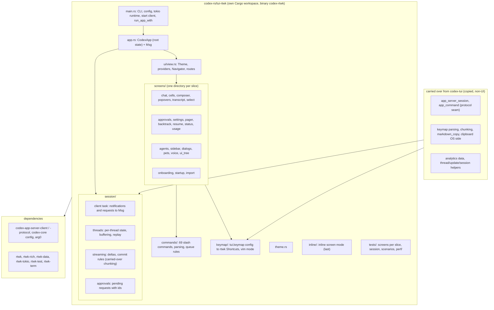
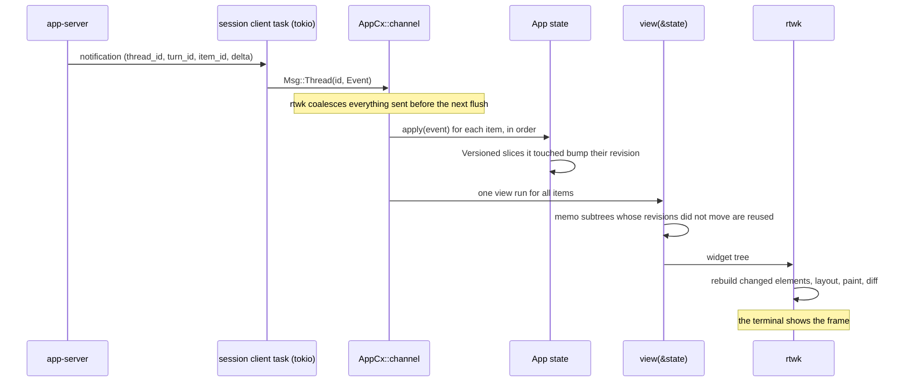
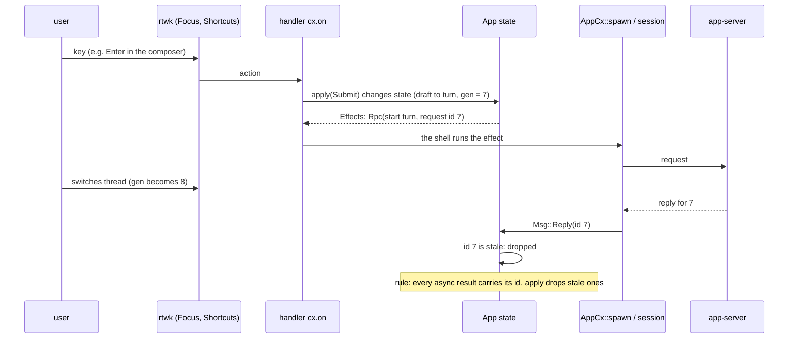
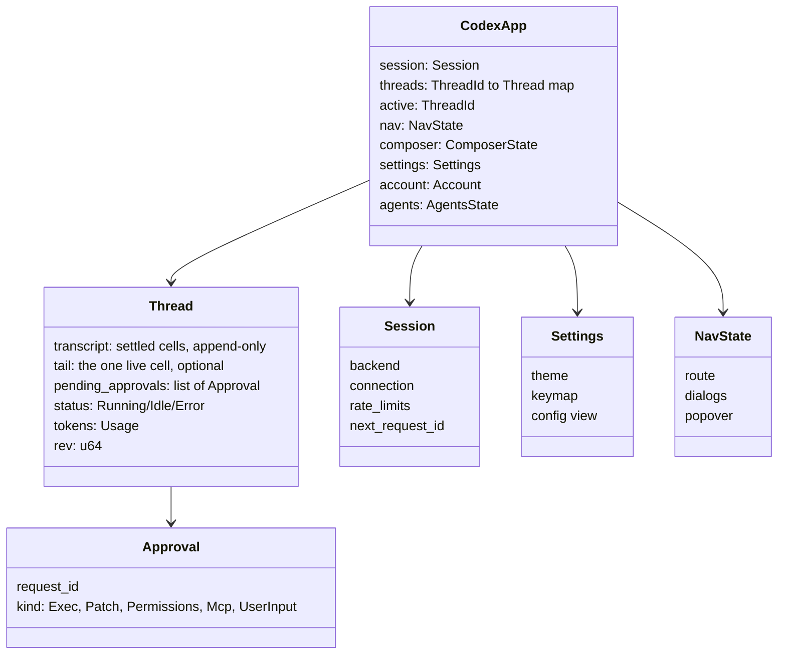
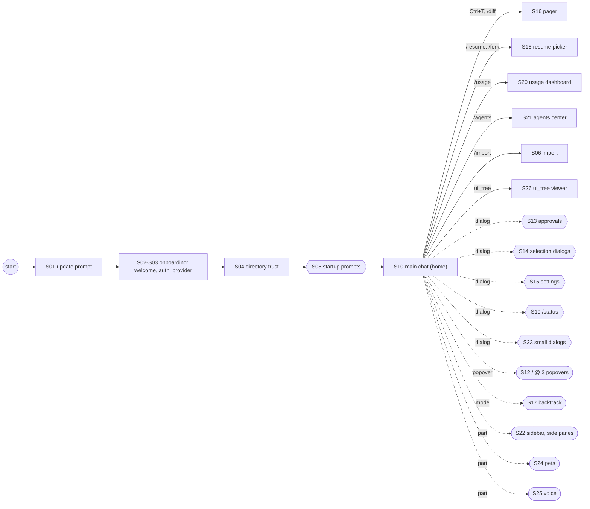
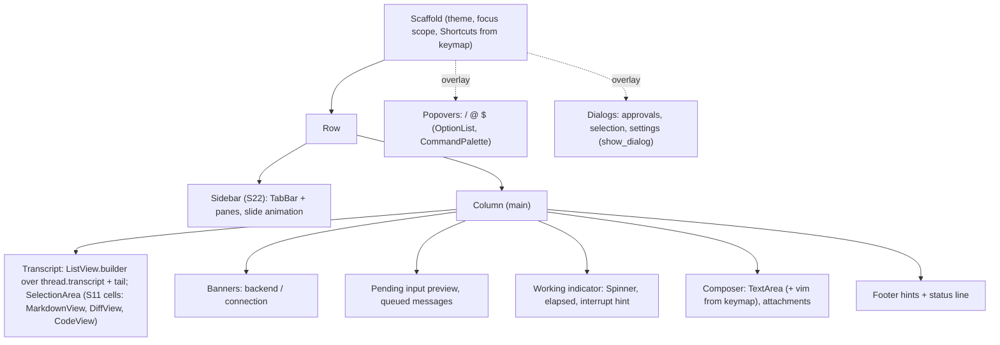
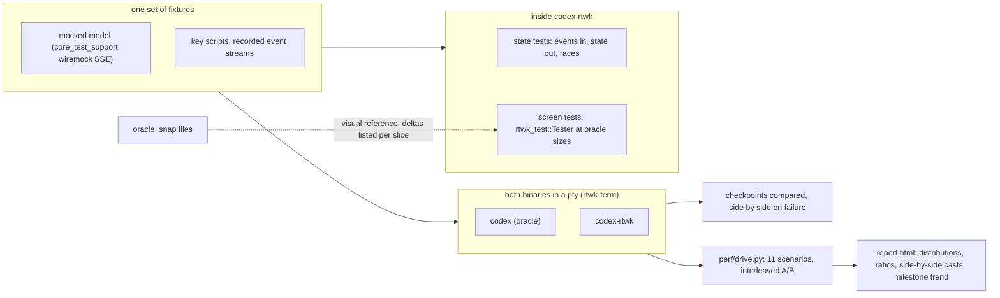
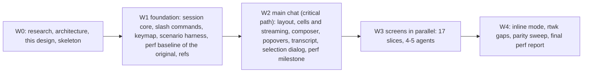

# Codex CLI on rtwk — target architecture (design to review)

What the finished phase-1 app looks like, drawn to be looked at, weighed and
changed before the migration starts. Text decisions: [architecture.md](architecture.md).
Rendered: [design.html](design.html). App state follows ADR-003 (plain model,
`apply -> Effects`, chosen on the trade-offs in research/state-approaches.md),
in review with the person.

## 1. System context

## 2. Who owns what

## 3. Crate and module layout

## 4. Runtime: an event from the backend reaches the screen

## 5. Runtime: a user action and a late reply

## 6. App state shape

Derived (computed, never stored by hand): per-thread unread and running,
total tokens, sidebar filter results, agents-center counts, footer hints,
what the status line shows.

## 7. Navigation map (screens of architecture.md §1)

## 8. Main chat screen: widget tree

## 9. Tests, parity and performance

## 10. Migration waves (tm `tui-rtwk`)

## Open points on this design

1. App state (§4–§6) per ADR-003; the person reviews the trade-off analysis
   (`research/state-approaches.md`).
2. Which reusable codex-tui modules are copied in W1 vs with their screen
   (§3 "carried over") — from reuse-map.csv per slice.
3. Sidebar and side panes as part of the chat screen (§8) or a split layout
   of their own.
