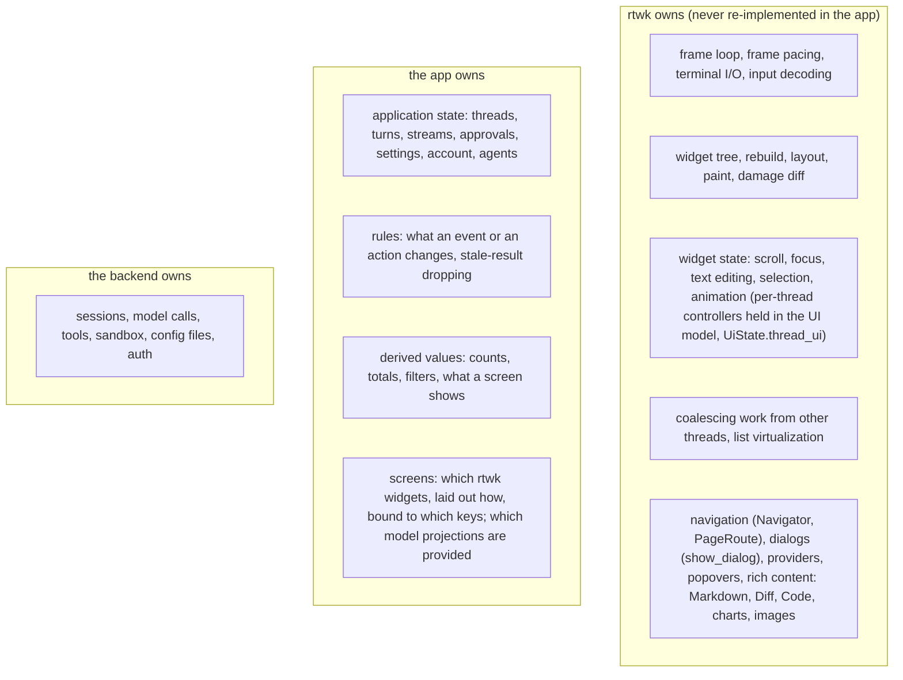
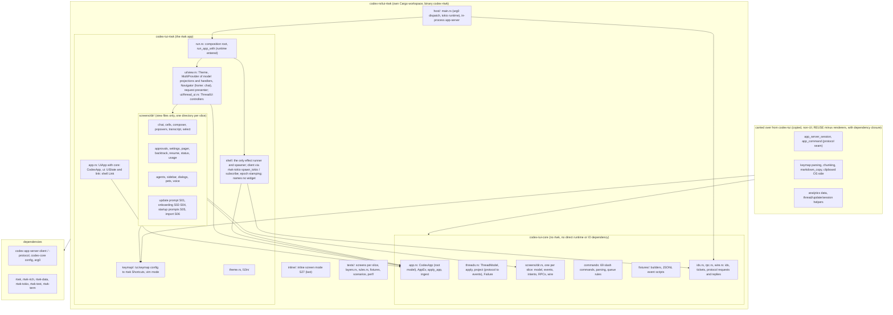
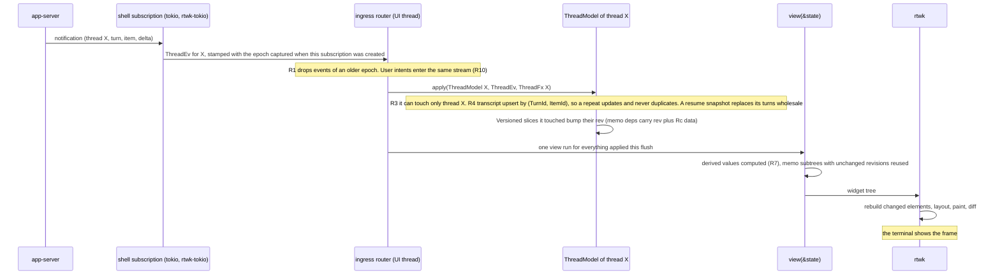
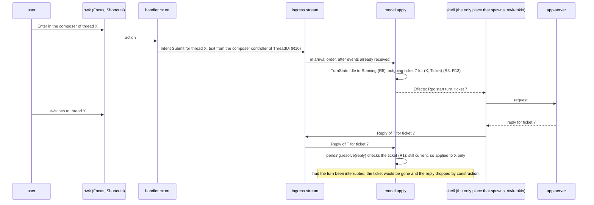
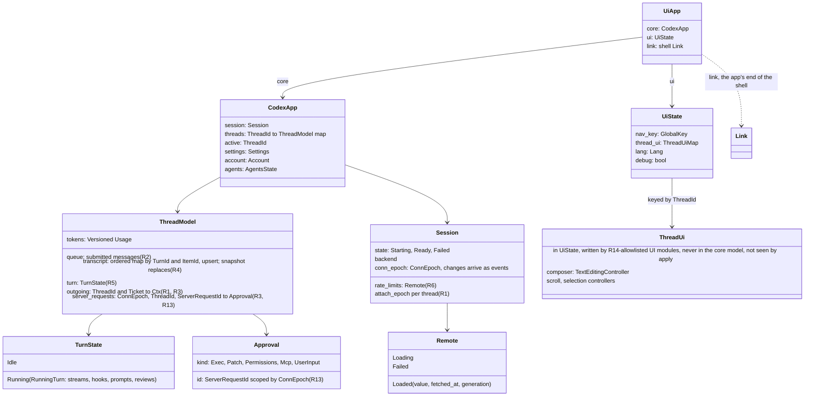
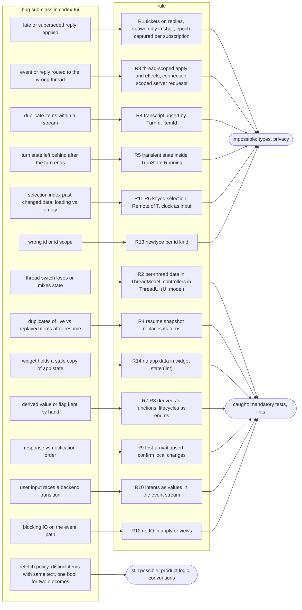
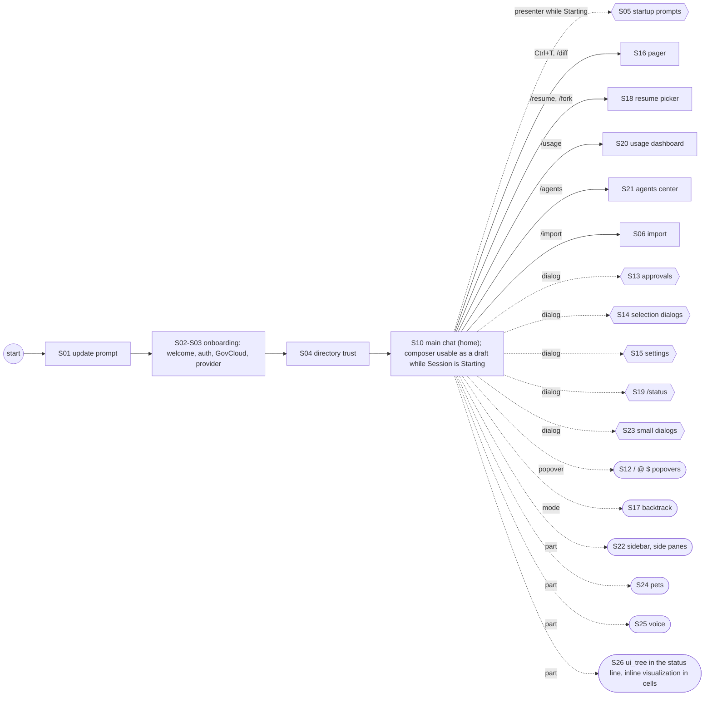
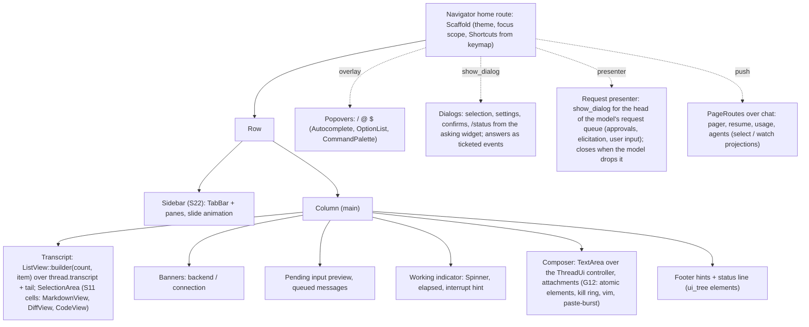
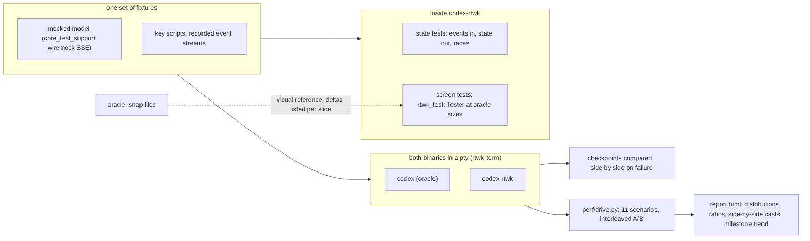
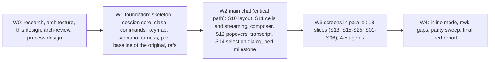

# Codex CLI on rtwk — target architecture (design to review)

What the finished phase-1 app looks like, drawn to be looked at, weighed and
changed before the migration starts. Text decisions: [architecture.md](architecture.md).
Rendered: [design.html](design.html). App state follows ADR-003, accepted by the person
2026-11-17: plain model, thread-scoped `apply -> Effects`, intents on shared
state as values, rules R1–R14 (§6b). Corrected after the independent review
[reviews/arch-review.md](reviews/arch-review.md): navigation and dialogs as in
twk — `Navigator` + `PageRoute`, `show_dialog`, live data through
`rtwk::provider` projections of the model (§2, §3, §7, §8), `ThreadUi` for per-thread widget state, held in the UI model, not the core one (§6), the shell
spawns through rtwk-tokio (§4, §5), split pending maps (§6), counts in §6b.

## 1. System context

## 2. Who owns what

## 3. Crate and module layout

Two crates in one workspace and the arrows that are allowed (§3b says which
rule holds each one): the core has no rtwk and no direct runtime or IO dependency (the protocol crate pulls tokio in transitively); the UI crate holds the
views, the shell and the composition root; the host is the binary's backend.

### 3b. Layers: what may name what

| layer | may name | may not name | held by |
|---|---|---|---|
| core | the protocol crate, serde, std without IO, clock or threads | rtwk, tokio, futures, UI types, IO | the compiler (no rtwk in `core/Cargo.toml`) and an allowlist of direct dependencies; `core/clippy.toml` (calls and types); `layers.rs`: `core_manifest_has_no_ui_or_runtime_dependency`, `core_sources_name_no_ui_runtime_or_io`, `core_sources_hold_no_user_visible_prose`, `the_ui_model_is_the_core_model_plus_ui_state` |
| view (`screens/dir/`, `ui/`, `l10n/`, `theme`) | core, rtwk widgets, its own strings | the protocol, `core::wire`, shell, tokio, IO, `apply` | `layers.rs`: `views_never_name_protocol_shell_tokio_or_io`, `views_never_apply_the_model`, `screen_dirs_hold_view_files_only`, `every_screen_dir_has_a_core_half_and_a_view_half`; `rules.rs`: R14, ADR-010 |
| shell | core, the protocol, tokio, rtwk `Cx` and `DialogResult` (to spawn) | widgets, views, theme | `layers.rs`: `shell_names_no_widget`; `rules.rs`: `r1_spawn_paths_are_the_shells`, `r11_r12_no_clock_and_no_file_system_outside_the_shell` |
| run, host | everything (the composition) | - | `rules.rs`: `r1_the_host_neither_spawns_nor_allows` |

## 4. Runtime: an event from the backend reaches the screen

## 5. Runtime: a user action and a late reply

## 6. App state shape

Derived (functions of the model, never stored, R7): per-thread unread and
running, total tokens, sidebar filter results, agents-center counts, footer
hints, what the status line shows, `can_submit` and other predicates (R8).
Not allowed: app data in rtwk widget-local state (`Obs`, `use_state`,
hand-written `State`, controllers) outside UI-only modules — R14; IO in
`apply` or views — R12; the clock read in views — R11. `ThreadUi`, kept in the UI model (`UiApp.ui`) and never in `CodexApp`, holds
per-thread controllers (composer text, scroll, selection) so A→B→A keeps
them; the model never mirrors the draft — the text enters `apply` as an
intent on submit. App-scoped events (account, rate limits, app-level MCP
startup) go through `apply_app(&mut CodexApp, AppEv, &mut AppFx)`.

## 6b. Bug classes removed by construction (ADR-003, accepted 2026-11-17)

Checked on codex-tui's real history (research/state-bug-classes.md; the
report for openai/codex developers: [reports/tui-bug-classes.html](reports/tui-bug-classes.html)).
Of 55 state-mechanism fix commits: 20 impossible by construction, 33 caught
by a mandatory test or lint, 2 still possible (after arch-review M2/M4: SC6a
is caught by R14's lint, not impossible; the live+replayed case of SC4a,
6107b9886, is caught by the snapshot-replaces test).

Mandatory tests the rules imply: switch round-trip (A→B→A), end-path matrix
(complete / interrupt / fail × feature), event-permutation property tests,
lifecycle × intent table, `Model::assert_consistent()` after every event.
Lints (own `clippy.toml`; crate-wide deny, `#[allow]` only on allowlisted
modules, a CI grep rejects other allows): every spawn path outside the shell
(`AppCx::spawn`, `Cx::spawn`, rtwk-tokio spawn/subscribe/follow,
`std::thread::spawn`, `tokio::spawn`, `AppCx::channel`), `Obs`/`use_state`/
hand-written `State`/controllers outside UI-only modules,
`Instant::now`/`SystemTime::now` in views, blocking IO in `apply`/views.
Plus the resume/reconnect-mid-turn test (transcript equals the snapshot).

## 7. Navigation map (screens of architecture.md §1)

As in twk: the root is a `Navigator` (home: chat) under a `MultiProvider` of
model projections. Screens (solid arrows) are `PageRoute`s pushed by the
widget that opens them and read live data with `select` / `watch`. Dialogs
(dotted) open with `show_dialog` from the asking widget. Backend requests
(approvals, elicitations, user input, startup prompts) open through the
request presenter and close themselves when the model drops the request.
Routes and dialogs get ids; results return to the model as ticketed events.

## 8. Main chat screen: widget tree

## 9. Tests, parity and performance

## 10. Migration waves (tm `tui-rtwk`)

## Open points on this design

1. App state (§4–§6b) per accepted ADR-003 and the arch-review fixes; the
   module split is settled in `skeleton-layers` (§3, §3b): `ThreadModel` in the
   core crate, `ThreadUi` in the UI model, the shell in the UI crate.
2. Which reusable codex-tui modules are copied in W1 vs with their screen
   (§3 "carried over") — from reuse-map.csv per slice.
3. Sidebar and side panes as part of the chat screen (§8) or a split layout
   of their own.
