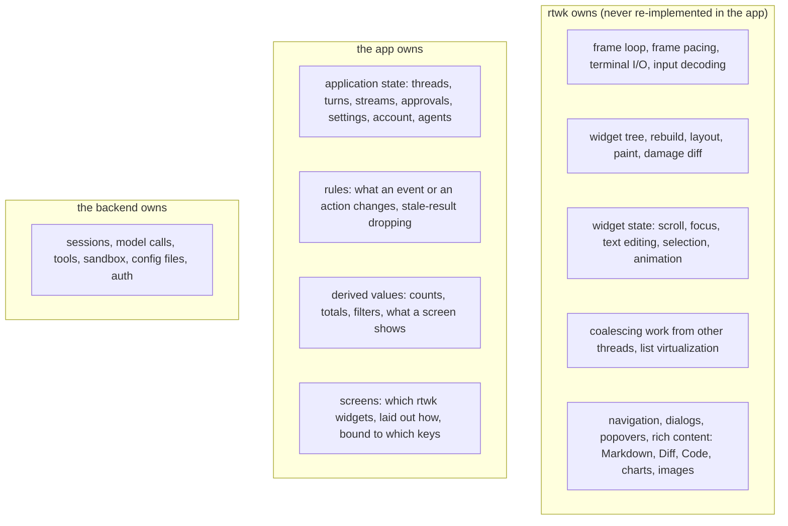
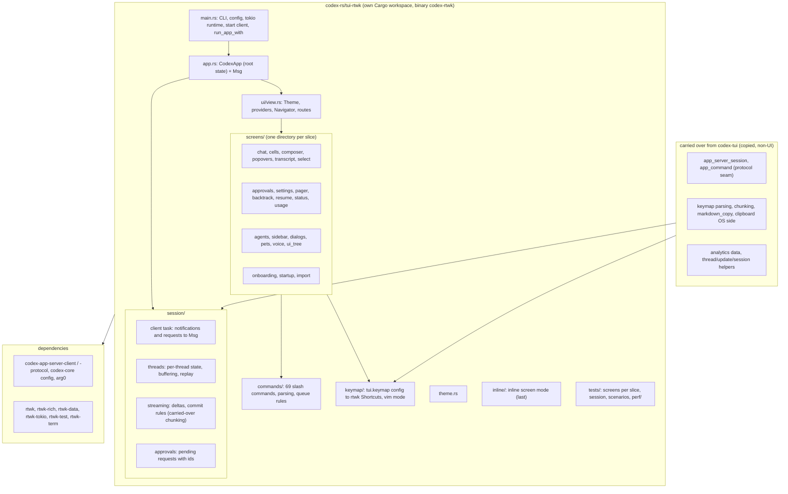
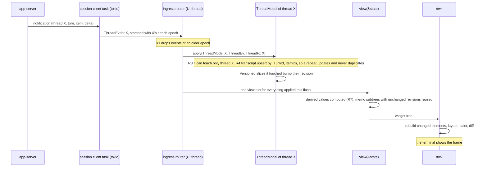
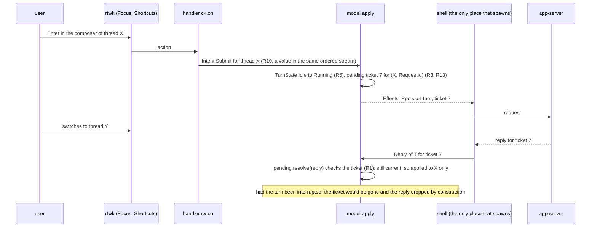
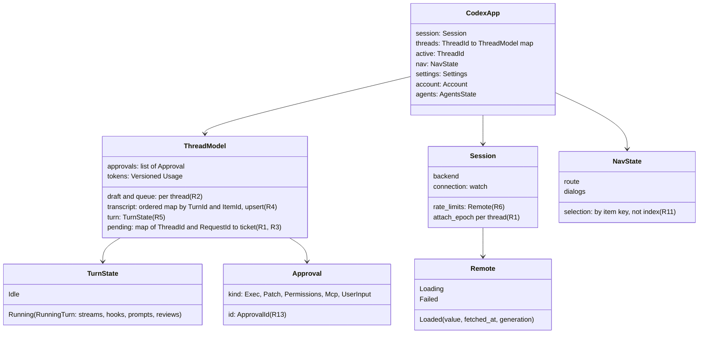
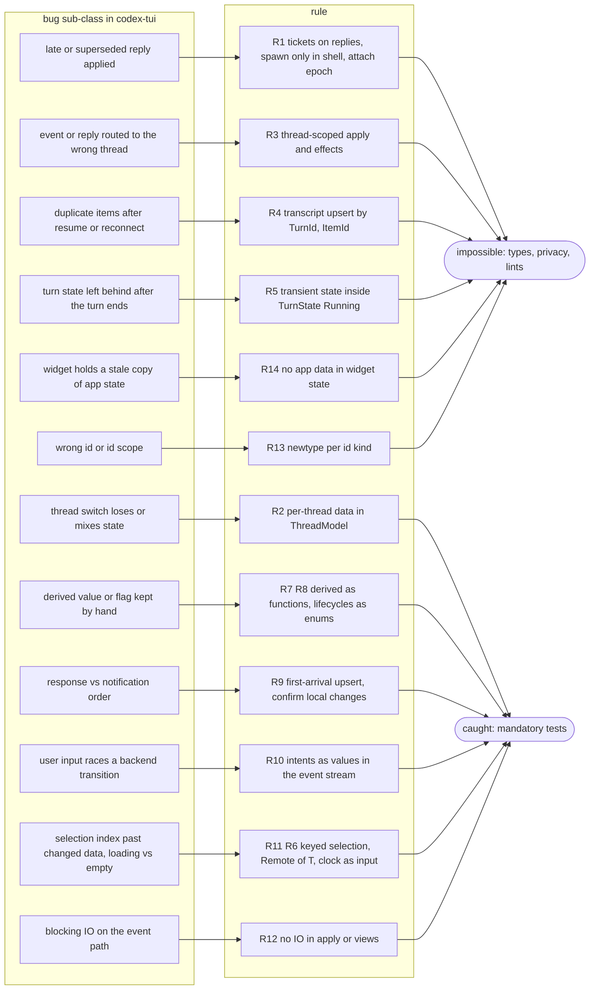
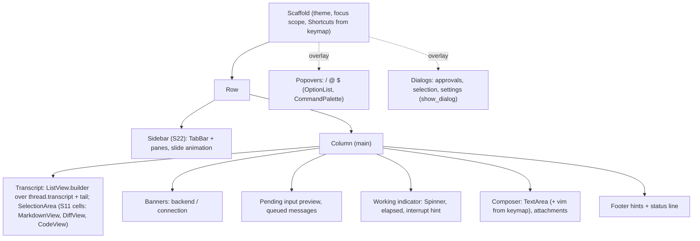
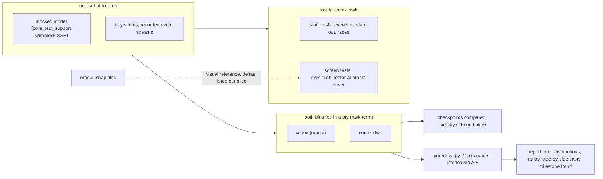
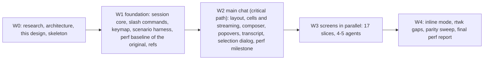

# Codex CLI on rtwk — target architecture (design to review)

What the finished phase-1 app looks like, drawn to be looked at, weighed and
changed before the migration starts. Text decisions: [architecture.md](architecture.md).
Rendered: [design.html](design.html). App state follows ADR-003, accepted by the person
2026-11-17: plain model, thread-scoped `apply -> Effects`, intents on shared
state as values, rules R1–R14 (§6b).

## 1. System context

## 2. Who owns what

## 3. Crate and module layout

## 4. Runtime: an event from the backend reaches the screen

## 5. Runtime: a user action and a late reply

## 6. App state shape

Derived (functions of the model, never stored, R7): per-thread unread and
running, total tokens, sidebar filter results, agents-center counts, footer
hints, what the status line shows, `can_submit` and other predicates (R8).
Not allowed: app data in rtwk widget-local state (`Obs`, `use_state`) — R14;
IO in `apply` or views — R12; the clock read in views — R11.

## 6b. Bug classes removed by construction (ADR-003, accepted 2026-11-17)

Checked on codex-tui's real history (research/state-bug-classes.md; the
report for openai/codex developers: [reports/tui-bug-classes.html](reports/tui-bug-classes.html)).
Of 55 state-mechanism fix commits: 28 impossible by construction, 25 caught
by a mandatory test, 2 still possible.

Mandatory tests the rules imply: switch round-trip (A→B→A), end-path matrix
(complete / interrupt / fail × feature), event-permutation property tests,
lifecycle × intent table, `Model::assert_consistent()` after every event.
Lints: `AppCx::spawn` outside the shell, `Obs`/`use_state` outside UI-only
modules, `Instant::now`/`SystemTime::now` in views, blocking IO in
`apply`/views.

## 7. Navigation map (screens of architecture.md §1)

## 8. Main chat screen: widget tree

## 9. Tests, parity and performance

## 10. Migration waves (tm `tui-rtwk`)

## Open points on this design

1. App state (§4–§6b) per accepted ADR-003; the exact module split of
   `ThreadModel` and the shell is settled in the skeleton.
2. Which reusable codex-tui modules are copied in W1 vs with their screen
   (§3 "carried over") — from reuse-map.csv per slice.
3. Sidebar and side panes as part of the chat screen (§8) or a split layout
   of their own.
