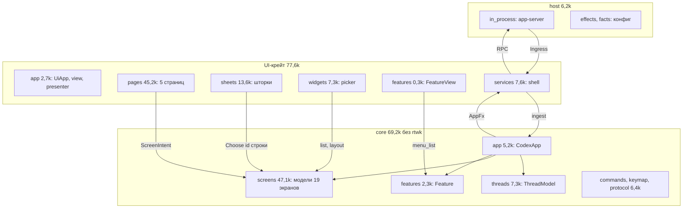
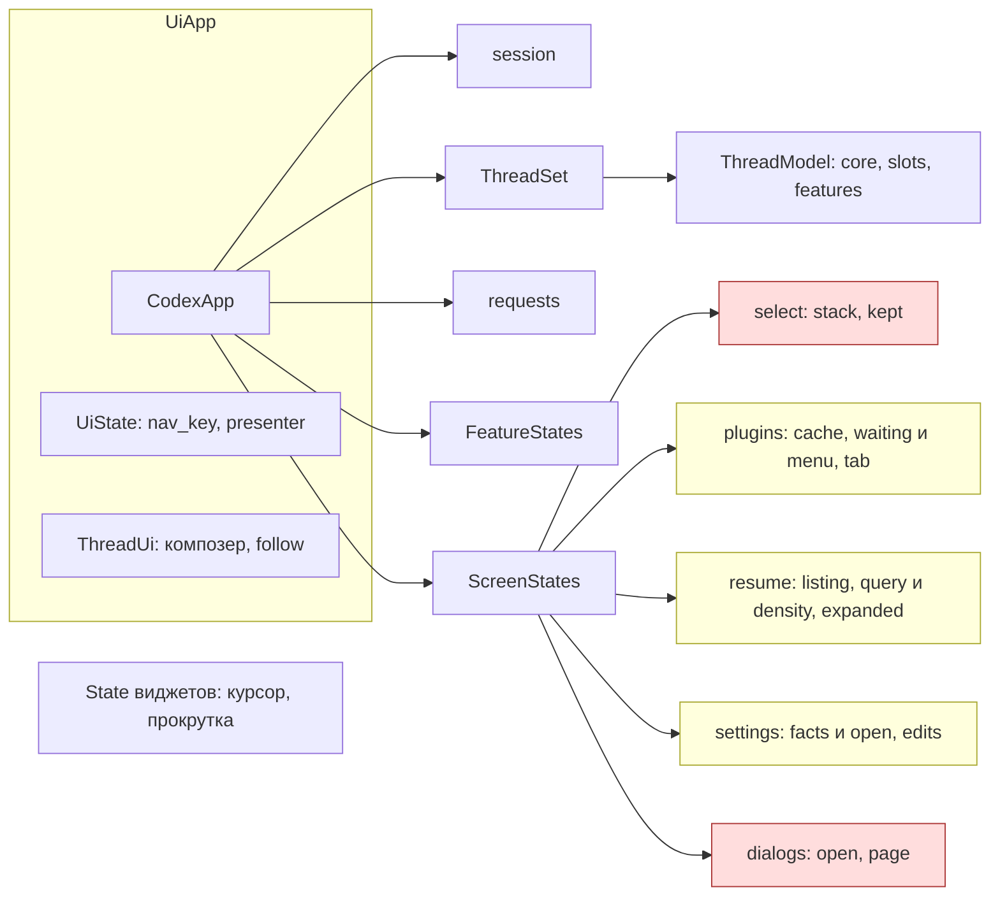
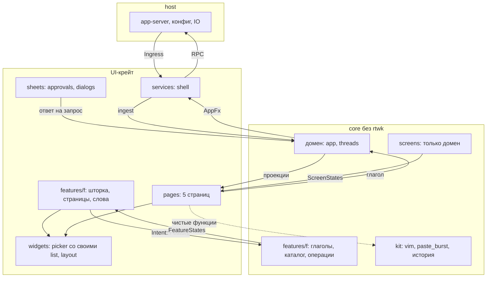
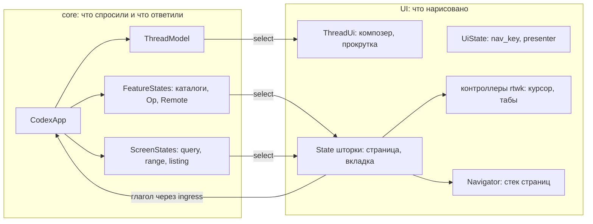
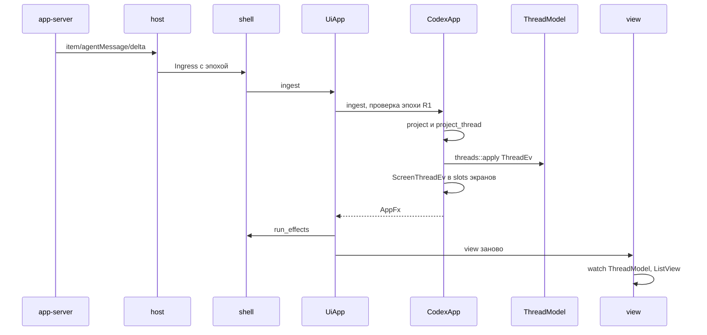
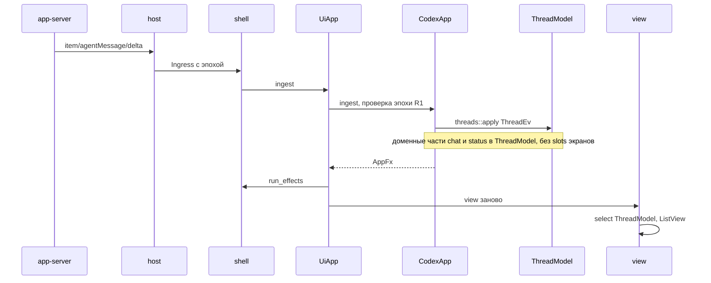
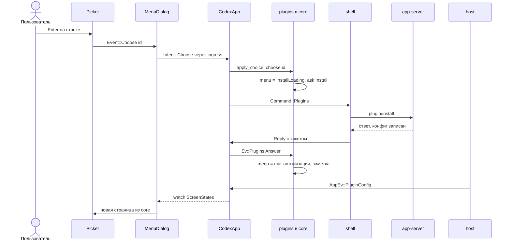
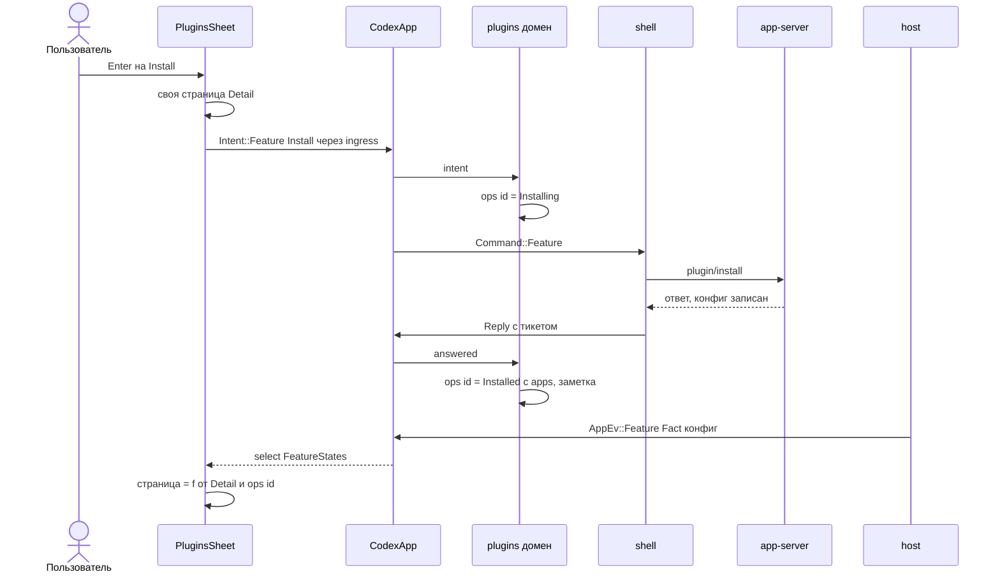
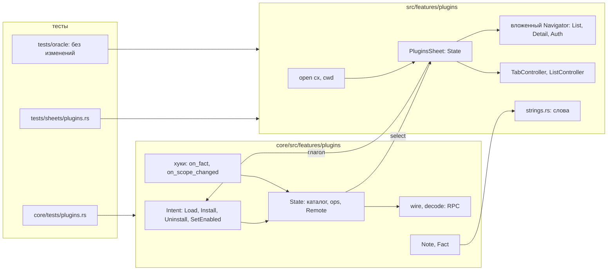

# arch-boundary: диаграммы

К [report.md](report.md). Числа — строки кода на `b2eeacb7c`.

## d1. Текущая карта слоёв и крейтов

## d2. Текущие владельцы состояния

Красное — отрисовка в core, жёлтое — смесь домена и отрисовки.

## d3. Целевая карта слоёв

## d4. Целевые владельцы состояния

## d5. Уведомление стрима хода: сейчас и в цели

Сейчас:

Цель (поток — домен, путь почти не меняется):

## d6. /plugins install: от клавиши до записи конфига и обновления

Сейчас:

Цель:

## d7. Фича в цели: обе половины

