# tui-rtwk: диаграммы целевой архитектуры

К [architecture.md](architecture.md) и [review.md](review.md). d1–d7 — исправленные схемы из `research/arch-boundary/diagrams.md` (695e300e5); что исправлено, сказано под каждой. d8–d15 — новые. Числа — строки кода на `b2eeacb7c`.

## d1. Текущая карта слоёв и крейтов

Исправлено: добавлены зависимость фич от picker (UI-формы в `Feature`), `outgoing` в core и шаги фикстур, строящие формы списков в core.

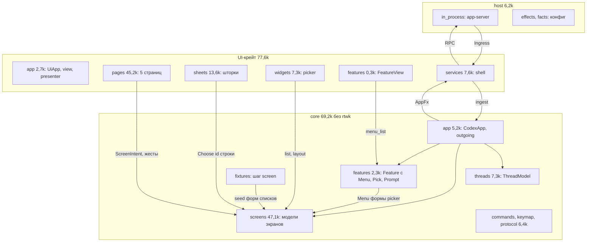

## d2. Текущие владельцы состояния

Красное — отрисовка в core, жёлтое — смесь. Исправлено: `plugins.shown`, `resume.previews`, слой presenter, `outgoing` без очистки на attach, четыре seq-слушателя.

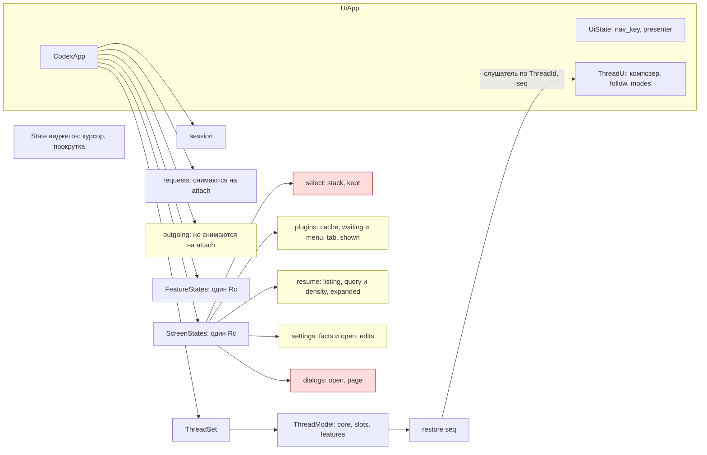

## d3. Целевая карта слоёв

Исправлено: kit — отдельный модуль без корней домена; шторки в `SheetHost` или через `show_dialog`; presenter-ы; виджеты не называют половины экранов.

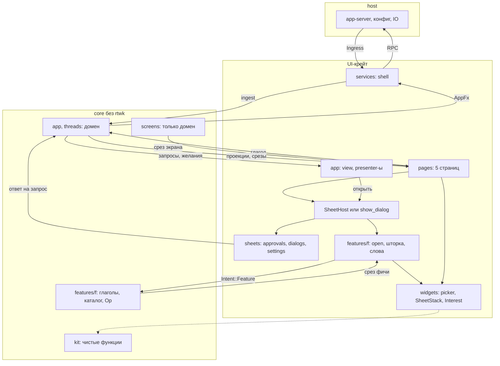

## d4. Целевые владельцы состояния

Исправлено: вложенный `Navigator` заменён на `SheetStack`; добавлены `Interest`, `Directive`, `SurfaceWish`, `ops` по `OpKey`, `awaiting`.

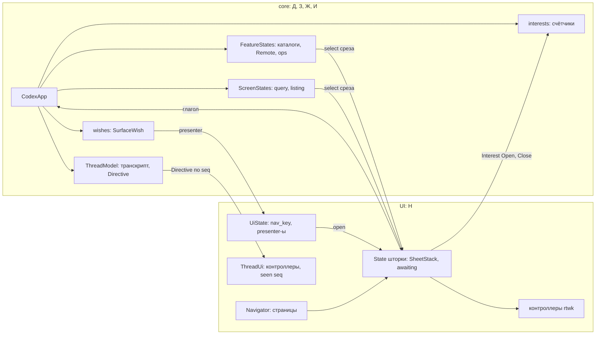

## d5. Уведомление стрима хода: сейчас и в цели

Сейчас (без изменений):

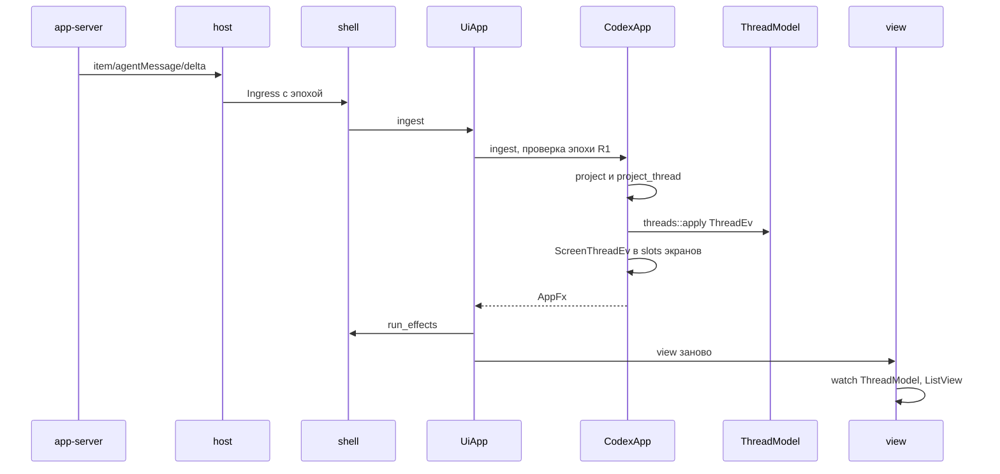

Цель. Исправлено: slots остаются, это доменные части экранов на поток (род Д), переносить их некуда. Меняются только срезы и `select`.

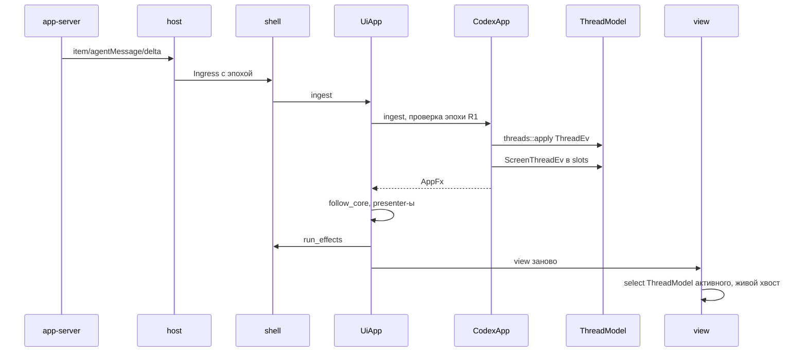

## d6. /plugins install: сейчас и в цели

Сейчас (без изменений):

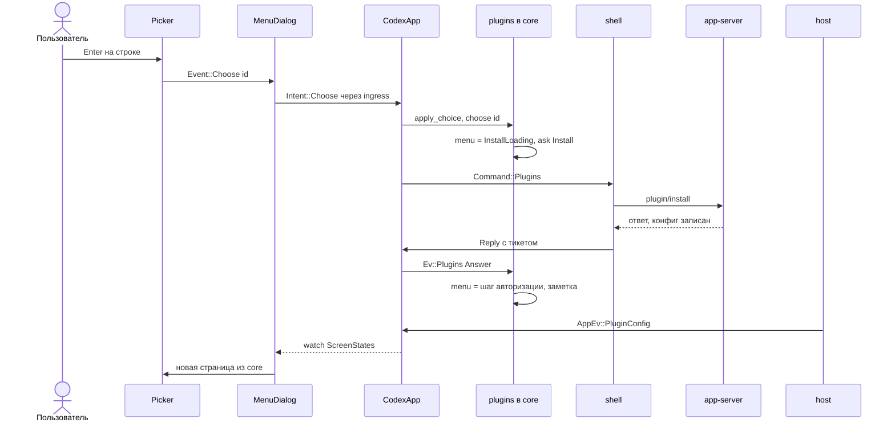

Цель. Исправлено: ожидание `awaiting` в шторке, ключ операции — `PluginKey` с `gen`, двойное нажатие схлопывается, Auth открывается желанием даже при закрытой шторке (как у оракула, plugins.rs:446-500).

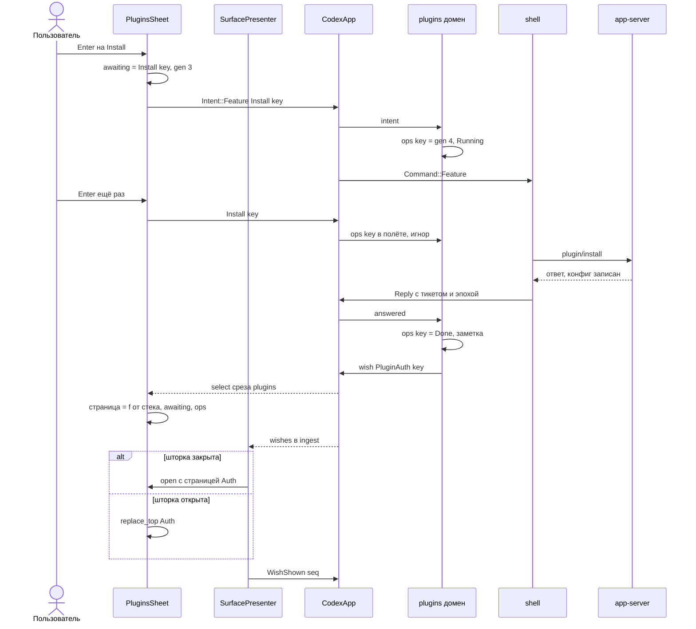

## d7. Фича в цели: обе половины

Исправлено: `SheetStack` вместо вложенного `Navigator`; `Wish`, `Interest`, `on_interest`; правила.

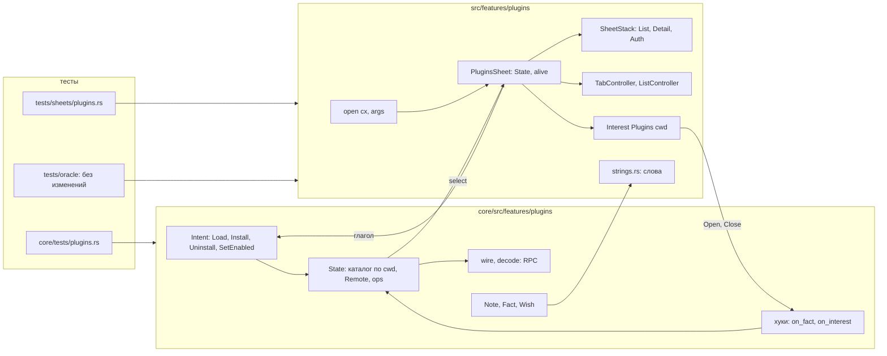

## d8. Запуск

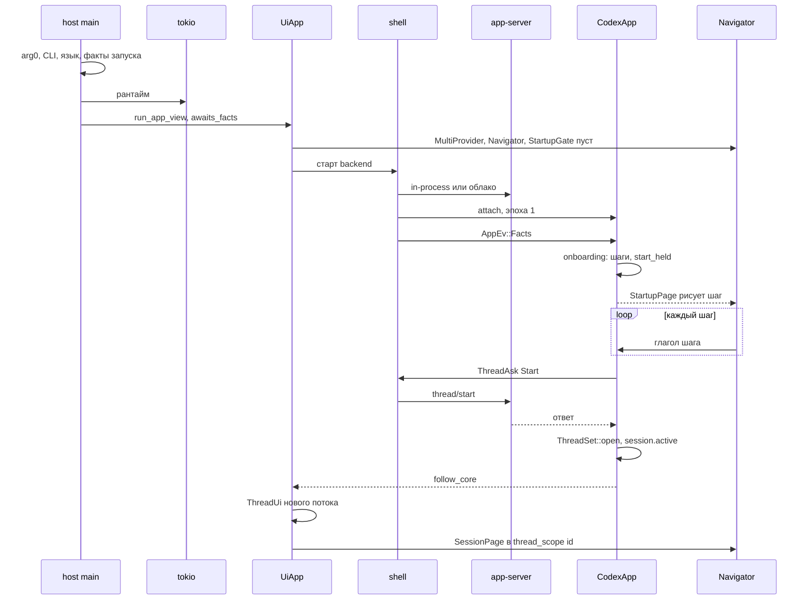

## d9. Поток: переключение и переподключение

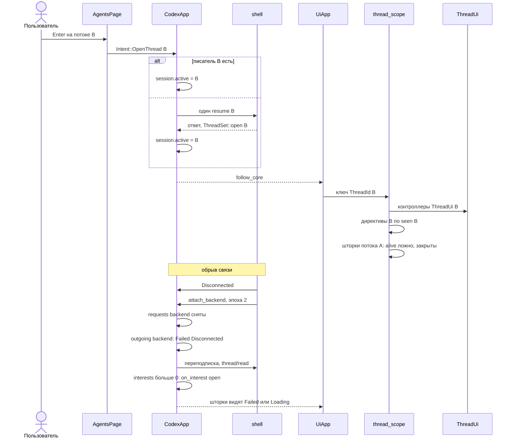

## d10. Шторка: жизнь и закрытие доменом

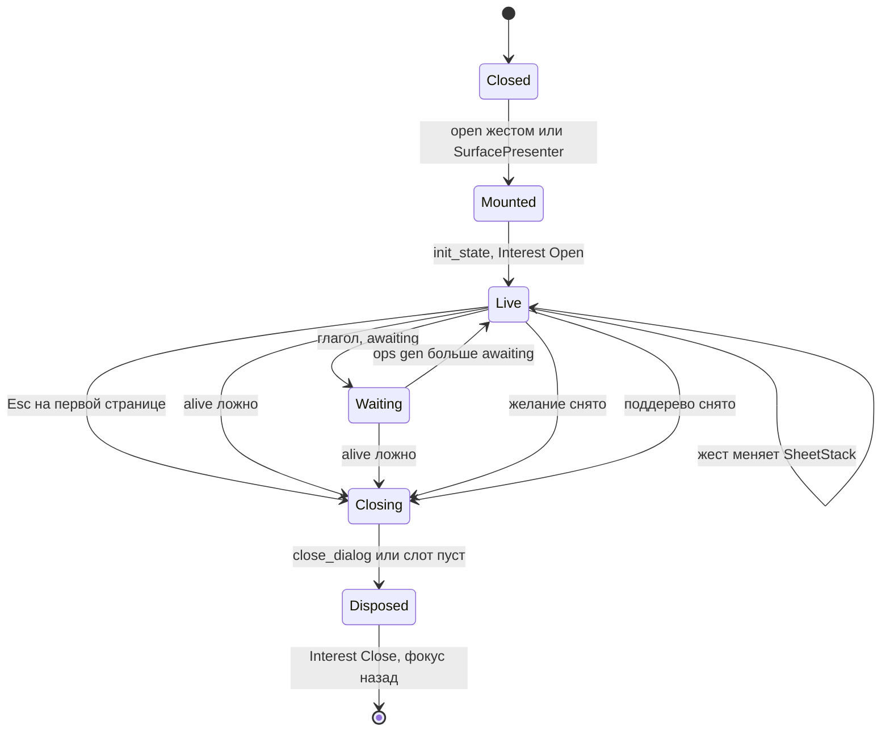

## d11. Директива контроллеру

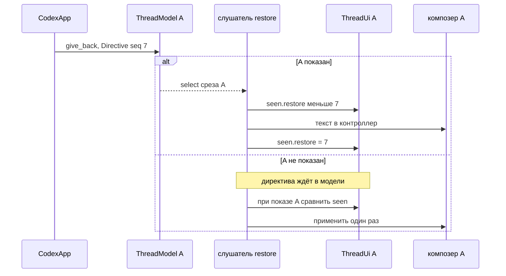

## d12. Интерес поверхности

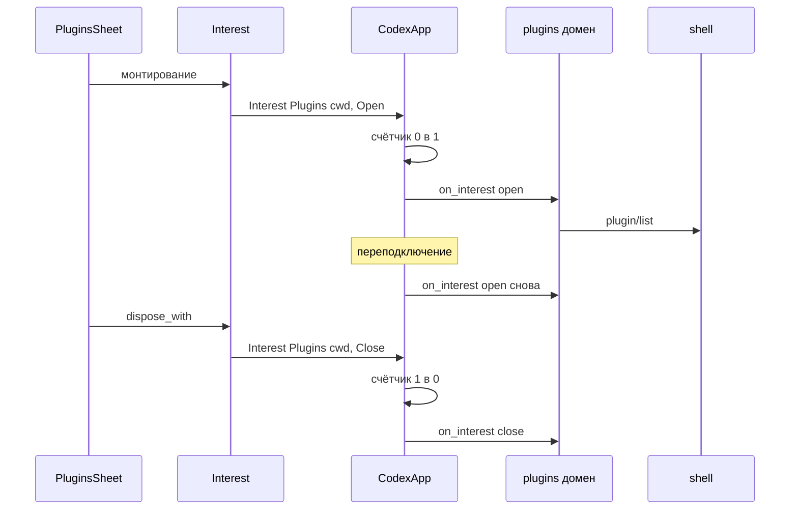

## d13. Карта модулей и ответственности

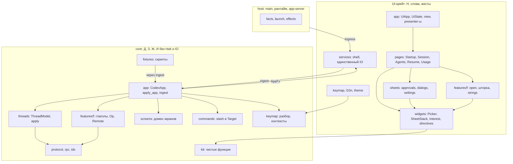

## d14. Пирамида тестов

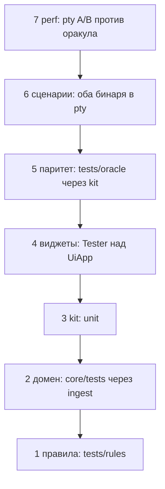

## d15. Фокус и клавиши

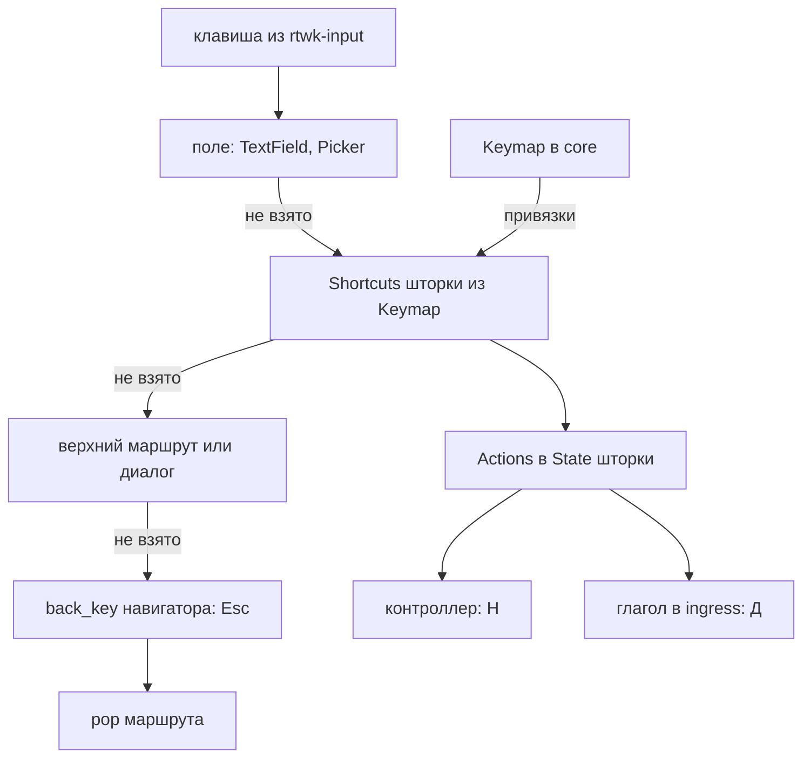
